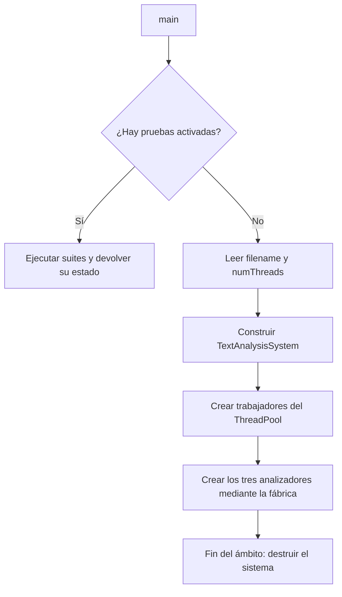
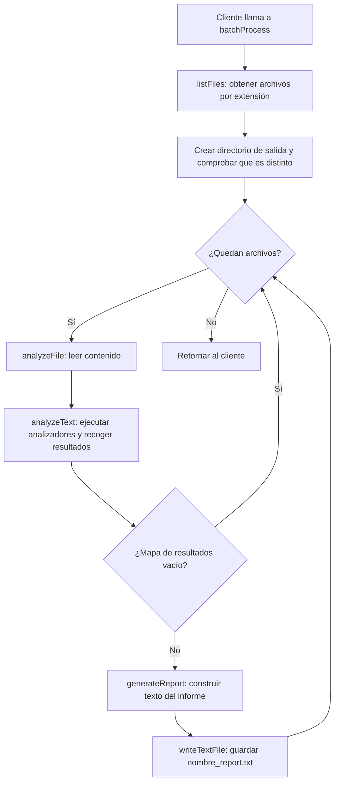
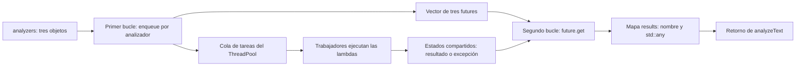
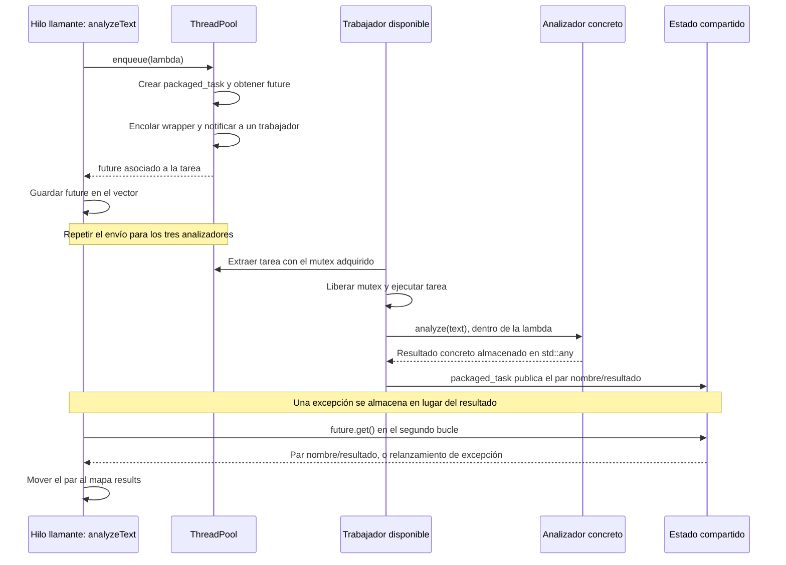

# Flujo de TextAnalysisSystem

Los diagramas usan Mermaid: se pueden visualizar en un visor Markdown compatible con Mermaid. El documento describe la implementación actual del proyecto.

## 1. Qué ejecuta actualmente `main`

Si hay suites de pruebas activadas mediante `RunConfig.h`, `main` las ejecuta y termina. Si no hay pruebas activadas, lee los argumentos y construye `TextAnalysisSystem`.

**Actualmente `main` todavía no llama a `analyzeFile`, `analyzeText` ni `batchProcess`.** Aunque lee `filename`, no lo utiliza después para analizarlo. Los flujos de análisis de este documento se ejecutan cuando un cliente llama explícitamente a esos métodos.



El constructor guarda los analizadores en un `vector<unique_ptr<TextAnalyzer>>`. Es el propietario de esos objetos. La fábrica crea un analizador de frecuencia, otro de legibilidad y otro de sentimiento.

## 2. Flujo de procesamiento por lotes



Los archivos se procesan **uno detrás de otro**. Dentro de cada archivo, los analizadores pueden ejecutarse en paralelo, según los trabajadores disponibles.

Los errores de preparación del lote se propagan. `analyzeFile` captura excepciones estándar, informa del error y devuelve un mapa vacío; `batchProcess` omite ese archivo. Si falla la generación o escritura de un informe con una excepción estándar, informa del error y continúa con el siguiente archivo.

## 3. Los dos bucles de `analyzeText`

Tu interpretación es correcta: `analyzeText` envía una tarea por analizador al pool y después recoge los resultados mediante los futuros.

### Primer bucle: enviar tareas

Código simplificado de la implementación:

```cpp
for (const auto& analyzer : analyzers) {
    futures.push_back(threadPool.enqueue([analyzer = analyzer.get(), &text] {
        return std::make_pair(analyzer->getName(), analyzer->analyze(text));
    }));
}
```

En cada iteración:

1. Se construye una lambda que captura un puntero al analizador y una referencia al texto.
2. `enqueue` prepara la tarea y la coloca en la cola del pool.
3. `enqueue` devuelve un `future` asociado a esa tarea.
4. Ese `future` se mueve al vector `futures`.

El puntero no transfiere la propiedad del analizador. El texto tampoco se copia para cada tarea. Los trabajadores pueden comenzar a ejecutar tareas mientras el hilo llamante todavía está enviando las siguientes.

### Segundo bucle: recoger resultados

```cpp
for (auto& future : futures) {
    auto result = future.get();
    results.emplace(std::move(result.first), std::move(result.second));
}
```

`get()` espera si la tarea todavía no ha terminado. Si ya terminó, obtiene su resultado sin esperar a que se ejecute de nuevo. Si la tarea lanzó una excepción, `get()` la relanza en el hilo llamante.

La tarea devuelve un `pair<string, any>`: nombre del analizador y resultado. El segundo bucle mueve ambos miembros al mapa `results`.

**El vector guarda futuros, no directamente los resultados finales.** Cada futuro permite acceder al estado compartido donde la tarea publica un resultado o una excepción. El mapa es el contenedor de resultados que devuelve `analyzeText`.



Se envían todas las tareas antes de empezar el segundo bucle. Si hiciéramos `enqueue(...).get()` en cada iteración del primer bucle, esperaríamos a cada analizador antes de enviar el siguiente y perderíamos el solapamiento entre ellos.

## 4. Diagrama de secuencia: tareas, trabajadores y futuros

El diagrama representa una tarea; el envío se repite para cada analizador. El pool no asigna permanentemente un trabajador a un analizador.



La ejecución real puede intercalarse de otras formas: un trabajador puede terminar antes de que el llamante guarde el futuro, o `get()` puede empezar a esperar antes de que termine la tarea. El estado compartido coordina ambos casos.

## 5. Qué significa el paralelismo aquí

Con tres trabajadores disponibles, los tres analizadores pueden solaparse. Con uno solo, se ejecutan uno detrás de otro, pero el mismo código funciona.

Los futuros se recorren en orden de envío, no en orden de finalización. Si el analizador de frecuencia tarda más, el primer `get()` puede esperar mientras legibilidad y sentimiento ya han terminado. Sus resultados quedan disponibles en sus respectivos estados compartidos.

`batchProcess` no envía `analyzeFile` al mismo pool: esa función llama a `analyzeText`, que envía nuevas tareas y espera por ellas. Con un trabajador, la tarea exterior lo ocuparía esperando unas tareas interiores que no pueden ejecutarse. Por eso el llamante coordina los archivos y el pool ejecuta los analizadores.

## 6. Tipos que circulan por el sistema

| Objeto | Tipo o contenido | Función |
|---|---|---|
| `analyzers` | `vector<unique_ptr<TextAnalyzer>>` | Poseer los tres analizadores |
| Tarea enviada | Lambda que devuelve `pair<string, any>` | Ejecutar un analizador y asociar su nombre |
| `futures` | `vector<future<pair<string, any>>>` | Esperar y recuperar cada resultado |
| `results` | `map<string, any>` | Reunir los resultados por nombre |
| Resultado de frecuencia | `unordered_map<string, int>` dentro de `any` | Contar las palabras |
| Resultado de legibilidad | `ReadabilityAnalyzer::ReadabilityMetrics` dentro de `any` | Guardar las siete métricas |
| Resultado de sentimiento | `double` dentro de `any` | Guardar la puntuación |
| Informe | `string` | Presentar los resultados como texto |

`std::any` permite almacenar tipos distintos detrás de un mismo tipo de contenedor. `generateReport` utiliza `std::any_cast` con el tipo esperado para cada nombre de analizador.

## 7. Vida de los datos y excepciones

Las tareas toman prestados el texto y los analizadores. Por ello, `analyzeText` espera a las tareas aceptadas antes de salir, incluso si se produce una excepción durante el envío o la recogida. En su bloque `catch`, espera mediante `wait()` en los futuros que siguen siendo válidos y después relanza la excepción original.

`wait()` solo espera; `get()` obtiene el resultado o relanza su excepción. Después de llamar a `get()`, ese futuro ya no es válido, incluso si `get()` lanzó una excepción. Esto explica la comprobación `future.valid()` dentro del bloque de limpieza.

El llamante debe mantener vivo el sistema y no modificar el texto durante el análisis. Al finalizar una llamada normal o excepcional a `analyzeText`, sus tareas aceptadas ya no están usando esos datos.
