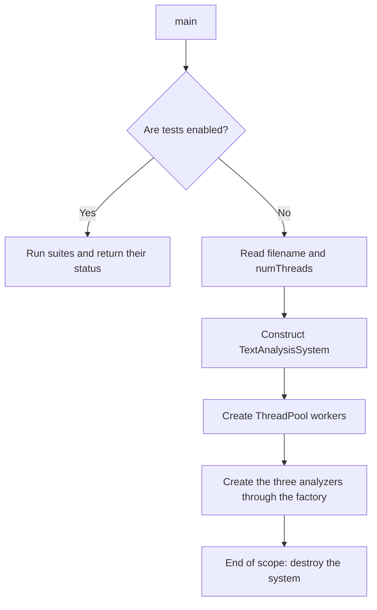
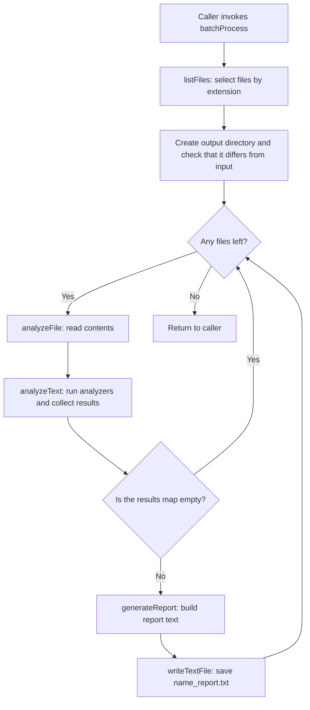
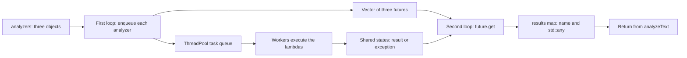
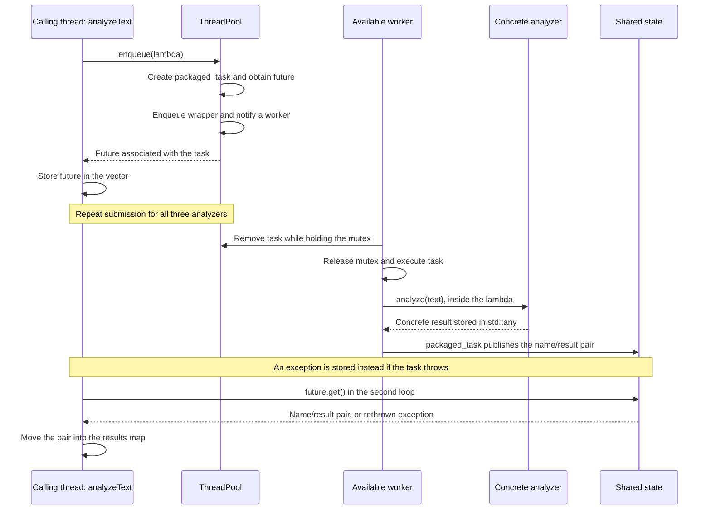

# TextAnalysisSystem Flow

The diagrams use Mermaid and can be displayed in a Markdown viewer with Mermaid support. This document describes the project's current implementation.

## 1. What `main` currently executes

If test suites are enabled through `RunConfig.h`, `main` runs them and exits. Otherwise, it reads the arguments and constructs `TextAnalysisSystem`.

**Currently, `main` does not yet call `analyzeFile`, `analyzeText`, or `batchProcess`.** Although it reads `filename`, it does not subsequently use it for analysis. The analysis flows below execute when a caller explicitly invokes these methods.



The constructor stores the analyzers in a `vector<unique_ptr<TextAnalyzer>>`, which owns those objects. The factory creates a word frequency analyzer, a readability analyzer, and a sentiment analyzer.

## 2. Batch processing flow



Files are processed **one at a time**. Within each file, the analyzers can run in parallel, depending on the available workers.

Batch setup errors propagate to the caller. `analyzeFile` catches standard exceptions, reports the error, and returns an empty map; `batchProcess` skips that file. If generating or writing a report throws a standard exception, the error is reported and processing continues with the next file.

## 3. The two loops in `analyzeText`

`analyzeText` submits one task per analyzer to the pool, then collects their results through futures.

### First loop: submit tasks

Simplified implementation code:

```cpp
for (const auto& analyzer : analyzers) {
    futures.push_back(threadPool.enqueue([analyzer = analyzer.get(), &text] {
        return std::make_pair(analyzer->getName(), analyzer->analyze(text));
    }));
}
```

Each iteration performs these steps:

1. Construct a lambda that captures a pointer to the analyzer and a reference to the text.
2. `enqueue` prepares the task and places it in the pool's queue.
3. `enqueue` returns a `future` associated with that task.
4. The `future` is moved into the `futures` vector.

The pointer does not transfer ownership of the analyzer. The text is not copied for each task either. Workers may start executing tasks while the calling thread is still submitting the remaining ones.

### Second loop: collect results

```cpp
for (auto& future : futures) {
    auto result = future.get();
    results.emplace(std::move(result.first), std::move(result.second));
}
```

`get()` waits if the task has not finished yet. If it has already finished, `get()` retrieves its result without executing it again. If the task threw an exception, `get()` rethrows it in the calling thread.

The task returns a `pair<string, any>` containing the analyzer's name and result. The second loop moves both members into the `results` map.

**The vector stores futures, rather than the final results directly.** Each future provides access to the shared state where its task publishes a result or an exception. The map is the result container returned by `analyzeText`.



All tasks are submitted before the second loop begins. Calling `enqueue(...).get()` in each iteration of the first loop would wait for each analyzer before submitting the next one, preventing their execution from overlapping.

## 4. Sequence diagram: tasks, workers, and futures

This diagram represents one task; submission is repeated for each analyzer. The pool does not permanently assign a worker to an analyzer.



Actual execution can interleave differently: a worker may finish before the caller stores the future, or `get()` may start waiting before the task finishes. The shared state coordinates both cases.

## 5. What parallelism means here

With three available workers, all three analyzers can overlap. With only one worker, they execute one after another, but the same code still works.

Futures are visited in submission order, not completion order. If the frequency analyzer takes longer, the first `get()` may wait while readability and sentiment have already finished. Their results remain available in their respective shared states.

`batchProcess` does not submit `analyzeFile` to the same pool: that function calls `analyzeText`, which submits new tasks and waits for them. With one worker, the outer task would occupy it while waiting for inner tasks that cannot run. This is why the caller coordinates the files and the pool executes the analyzers.

## 6. Types flowing through the system

| Object | Type or contents | Purpose |
|---|---|---|
| `analyzers` | `vector<unique_ptr<TextAnalyzer>>` | Own the three analyzers |
| Submitted task | Lambda returning `pair<string, any>` | Run an analyzer and associate its name |
| `futures` | `vector<future<pair<string, any>>>` | Wait for and retrieve each result |
| `results` | `map<string, any>` | Collect results by name |
| Frequency result | `unordered_map<string, int>` inside `any` | Count words |
| Readability result | `ReadabilityAnalyzer::ReadabilityMetrics` inside `any` | Store the seven metrics |
| Sentiment result | `double` inside `any` | Store the score |
| Report | `string` | Present results as text |

`std::any` allows different payload types to be stored through a single container value type. `generateReport` uses `std::any_cast` with the expected type for each analyzer name.

## 7. Data lifetime and exceptions

Tasks borrow the text and the analyzers. Therefore, `analyzeText` waits for accepted tasks before leaving, even if an exception occurs during submission or result collection. Its `catch` block calls `wait()` on futures that are still valid, then rethrows the original exception.

`wait()` only waits; `get()` retrieves the result or rethrows its exception. After `get()` is called, that future is no longer valid, even if `get()` threw an exception. This explains the `future.valid()` check in the cleanup block.

The caller must keep the system alive and must not modify the text during analysis. When `analyzeText` returns or propagates an exception, its accepted tasks are no longer using those borrowed objects.
